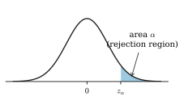
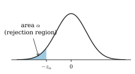
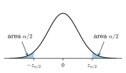
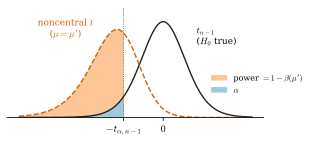
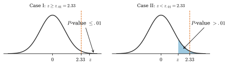
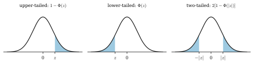

# Chapter 9: Tests of Hypotheses Based on a Single Sample

*Bilkent University MATH 260 lecture notes, Spring 2026. [Back to contents](../README.md)*

## 9.1 Hypotheses and Test Procedures

Example: **Null hypothesis** $H_0:\mu = 50$, **alternative hypothesis** $H_a:\mu \neq 50$.

There are two possible outcomes:

1.  If the evidence obtained from the sample strongly supports the alternative hypothesis $H_a$, then we *reject* $H_0$.

2.  If the evidence from the sample does not support $H_a$, then we *fail to reject* $H_0$.

**Test procedure.** A test procedure has two components:

1.  A **test statistic**: a function of the sample. The decision is based on the test statistic.

2.  A **rejection region**: the set of computed values of the test statistic for which $H_0$ is rejected.

The null hypothesis is rejected if the observed (computed) value of the test statistic falls in the rejection region.

**The errors.** There are two potential errors in a statistical test procedure:

1.  **Type I error**: rejecting $H_0$ when it is true.

2.  **Type II error**: not rejecting $H_0$ when it is false.

Their probabilities are denoted by $\alpha$ and $\beta$:

$$
\begin{aligned}
\alpha &= P(\text{type I error}) = P(H_0 \text{ is rejected when it is true}),\\
\beta  &= P(\text{type II error}) = P(H_0 \text{ is not rejected when it is false}).
\end{aligned}
$$

- The probability of rejecting $H_0$ when it is true, $\alpha$, is called the **significance level**.

- The probability of rejecting $H_0$ when it is false is called the **power** of the test procedure; it equals $1-\beta$.

Suppose that the parameter of interest is $\theta$ and the null hypothesis is $H_0:\theta=\theta_0$, where $\theta_0$ is the *null value*. The alternative hypothesis appears in one of three forms (the equality always belongs to $H_0$):

1.  $H_a:\theta \gt  \theta_0$ (implicitly $H_0:\theta \le \theta_0$)

2.  $H_a:\theta \lt  \theta_0$ (implicitly $H_0:\theta \ge \theta_0$)

3.  $H_a:\theta \neq \theta_0$ ($H_0:\theta = \theta_0$)

**Formulating hypotheses (example).** For a disease, the current drug gives an average life time of 12 months. A new drug (Drug 2) is claimed to give an average life time of 24 months. We test

$$
H_0:\mu = 12 \qquad\text{vs.}\qquad H_a:\mu \gt  12,
$$

where $\mu$ is the mean life time under the new drug, using e.g. a sample of 50 patients and their sample mean $\bar{x}$.

## 9.2 Tests About a Population Mean

**Case I: normal population, $\sigma$ known.**

Assumptions: (1) the population distribution is normal; (2) $\sigma$ is known.

Consider the standardized $\bar{X}$ under the assumption that $H_0$ is true:

$$
Z = \frac{\bar{X}-\mu_0}{\sigma/\sqrt{n}} \quad\longrightarrow\quad z = \frac{\bar{x}-\mu_0}{\sigma/\sqrt{n}}.
$$

Here $z$ measures the distance between $\bar{x}$ and $\mu_0$ in “standard deviation units”. Take $H_a:\mu\gt \mu_0$ (i.e. $H_0:\mu\le\mu_0$):

1.  *Large positive $z$*: the difference between $\bar{x}$ and $\mu_0$ is large, so $z$ is positive and large. This is evidence for $H_a$.

2.  *Small positive $z$*: $\bar{x}$ is only a little bit greater than $\mu_0$; we attribute this to random luck and fail to reject $H_0$ (the evidence is not strong enough).

3.  *Negative $z$*: $\bar{x}\lt \mu_0$, we fail to reject $H_0$.

We only reject $H_0$ if $\bar{x}$ is *significantly* greater than $\mu_0$, i.e. $z$ must be greater than or equal to some positive value $c$. The rejection region is $z \ge c$.

The cutoff value $c$ is used to control the probability of a type I error at the desired level $\alpha$:

$$
\begin{aligned}
\alpha &= P(H_0 \text{ rejected when true}) = P(Z\ge c \text{ when } Z\sim N(0,1)) = 1-\Phi(c)\\
&\Rightarrow\; \Phi(c)=1-\alpha \;\Rightarrow\; c=\Phi^{-1}(1-\alpha)=z_\alpha .
\end{aligned}
$$

So the rejection region is $z\ge z_\alpha$ (right tail, area $\alpha$). This test procedure is called **upper-tailed**.

*Figure: Upper-tailed test: rejection region $z\ge z_\alpha$.*

Similarly, $H_a:\mu\lt \mu_0$ suggests the rejection region $z\le c=-z_\alpha$ (left tail, area $\alpha$); this test is called **lower-tailed**.

*Figure: Lower-tailed test: rejection region $z\le -z_\alpha$.*

Similarly, $H_a:\mu\ne\mu_0$ suggests the rejection region $z\le -c$ or $z\ge c$, i.e. either $z\le -z_{\alpha/2}$ or $z\ge z_{\alpha/2}$ (area $\alpha/2$ in each tail); this test is called **two-tailed**.

*Figure: Two-tailed test: rejection region $|z|\ge z_{\alpha/2}$.*

**Example.** Suppose $\alpha=.05$ is desired for the two-tailed test. Then

$$
.05 = P(Z\le -c \text{ or } Z\ge c) = \Phi(-c) + 1-\Phi(c) = 2[1-\Phi(c)]
\;\Rightarrow\; c = z_{.025} = 1.96 .
$$

**The one-sample $z$ test.** Null hypothesis $H_0:\mu=\mu_0$. Test statistic value: $z = \dfrac{\bar{x}-\mu_0}{\sigma/\sqrt{n}}$.

| Alternative hypothesis | Rejection region for level $\alpha$ test                        |
|:-----------------------|:----------------------------------------------------------------|
| $H_a:\mu\gt \mu_0$        | $z\ge z_\alpha$ (upper-tailed)                                  |
| $H_a:\mu\lt \mu_0$        | $z\le -z_\alpha$ (lower-tailed)                                 |
| $H_a:\mu\ne\mu_0$      | either $z\le -z_{\alpha/2}$ or $z\ge z_{\alpha/2}$ (two-tailed) |

**Power, $\beta$, and sample size determination for the one-sample $z$ test.** Consider the upper-tailed test with rejection region $z\ge z_\alpha$. This is equivalent to $\bar{x}\ge \mu_0 + z_\alpha\sigma/\sqrt{n}$, so $H_0$ is not rejected when $\bar{x}\lt \mu_0+z_\alpha\sigma/\sqrt{n}$. Let $\mu'$ be a particular value of $\mu$ that exceeds $\mu_0$. Then

$$
\begin{aligned}
\beta(\mu') &= P(H_0 \text{ is not rejected when it is false})
= P\!\left(\bar{X}\lt \mu_0+z_\alpha\sigma/\sqrt{n} \text{ when } \mu=\mu'\right)\\
&= P\!\left(\frac{\bar{X}-\mu'}{\sigma/\sqrt{n}} \lt  z_\alpha + \frac{\mu_0-\mu'}{\sigma/\sqrt{n}} \text{ when } \mu=\mu'\right)
= \Phi\!\left(z_\alpha + \frac{\mu_0-\mu'}{\sigma/\sqrt{n}}\right).
\end{aligned}
$$

This is the probability of a type II error for a level $\alpha$ test.

To determine the sample size we need two restrictions: (1) $\beta(\mu')=\beta$ and (2) $\alpha = P(\text{type I error})$. Then

$$
\Phi\!\left(z_\alpha + \frac{\mu_0-\mu'}{\sigma/\sqrt{n}}\right)=\beta
\;\Rightarrow\; z_\alpha + \frac{\mu_0-\mu'}{\sigma/\sqrt{n}} = \Phi^{-1}(\beta) = -z_\beta
$$

$$
\Rightarrow\; \frac{\mu_0-\mu'}{\sigma/\sqrt{n}} = -(z_\alpha+z_\beta)
\;\Rightarrow\; \sqrt{n} = \frac{\sigma(z_\alpha+z_\beta)}{\mu'-\mu_0}
\;\Rightarrow\; n = \left[\frac{\sigma(z_\alpha+z_\beta)}{\mu_0-\mu'}\right]^2
$$

for the upper-tailed procedure. In general:

| Alternative hypothesis | Type II error probability $\beta(\mu')$ for a level $\alpha$ test                                                                                |
|:-----------------------|:-------------------------------------------------------------------------------------------------------------------------------------------------|
| $H_a:\mu\gt \mu_0$        | $\Phi\!\left(z_\alpha + \dfrac{\mu_0-\mu'}{\sigma/\sqrt{n}}\right)$                                                                              |
| $H_a:\mu\lt \mu_0$        | $1-\Phi\!\left(-z_\alpha + \dfrac{\mu_0-\mu'}{\sigma/\sqrt{n}}\right)$                                                                           |
| $H_a:\mu\ne\mu_0$      | $\Phi\!\left(z_{\alpha/2} + \dfrac{\mu_0-\mu'}{\sigma/\sqrt{n}}\right) - \Phi\!\left(-z_{\alpha/2} + \dfrac{\mu_0-\mu'}{\sigma/\sqrt{n}}\right)$ |

In each case the power is $1-\beta(\mu')$. The sample size is

$$
n = \begin{cases}
\left[\dfrac{\sigma(z_\alpha+z_\beta)}{\mu_0-\mu'}\right]^2 & \text{for a one-tailed test},\\[3ex]
\left[\dfrac{\sigma(z_{\alpha/2}+z_\beta)}{\mu_0-\mu'}\right]^2 & \text{for a two-tailed test (approximately)}.
\end{cases}
$$

**Case II: the one-sample $t$ test.**

Assumptions: (1) the population distribution is normal; (2) $\sigma$ is unknown. Consider the random variable below under the assumption that $H_0$ is true:

$$
T = \frac{\bar{X}-\mu_0}{S/\sqrt{n}}, \qquad T\sim t_{n-1}.
$$

**Example.** Consider $H_0:\mu=\mu_0$ against $H_a:\mu\gt \mu_0$. Using the upper-tailed procedure,

$$
P(\text{type I error}) = P(H_0 \text{ rejected when true}) = P(T\ge t_{\alpha,n-1} \text{ when } T\sim t_{n-1}) = \alpha .
$$

**The one-sample $t$ test.** Null hypothesis $H_0:\mu=\mu_0$. Test statistic value: $t = \dfrac{\bar{x}-\mu_0}{s/\sqrt{n}}$.

| Alternative hypothesis | Rejection region for level $\alpha$ test                                |
|:-----------------------|:------------------------------------------------------------------------|
| $H_a:\mu\gt \mu_0$        | $t\ge t_{\alpha,n-1}$ (upper-tailed)                                    |
| $H_a:\mu\lt \mu_0$        | $t\le -t_{\alpha,n-1}$ (lower-tailed)                                   |
| $H_a:\mu\ne\mu_0$      | either $t\le -t_{\alpha/2,n-1}$ or $t\ge t_{\alpha/2,n-1}$ (two-tailed) |

**Some practical advice.**

1.  For large $n$, the $t$ test is (approximately) accurate regardless of the underlying population distribution.

2.  For small $n$, it is not.

3.  Since the $z$ and $t$ distributions are quite similar for large $n$, the cutoffs obtained from the $z$ test will be similar to the cutoffs obtained from the $t$ test.

**Power, $\beta$, and sample size determination for the one-sample $t$ test.**

*Sample size.* For large $n$, the sample size formulas obtained for the $z$ test can be used. Consider the one-tailed formula

$$
n = \left[\frac{\sigma(z_\alpha+z_\beta)}{\mu_0-\mu'}\right]^2 .
$$

To get rid of the unknown $\sigma$, we can

1.  replace $\sigma$ with $s$;

2.  use an estimate from a previous study;

3.  write $\mu'=\mu_0+d\sigma$, where $d$ is a positive or negative value.

Substituting $\mu'=\mu_0+d\sigma$ we get

$$
n = \left[\frac{\sigma(z_\alpha+z_\beta)}{\mu_0-\mu_0-d\sigma}\right]^2 = \left[\frac{z_\alpha+z_\beta}{d}\right]^2 .
$$

*Power and $\beta$.* For large $n$, we can use the $\beta(\mu')$ formulas from the $z$ test. Consider $H_a:\mu\gt \mu_0$. Then

$$
\beta(\mu') = \Phi\!\left(z_\alpha + \frac{\mu_0-\mu'}{\sigma/\sqrt{n}}\right),
$$

and we can use solutions 1, 2, 3 above to get rid of the unknown $\sigma$. Following 3,

$$
\beta(\mu') = \beta(\mu_0+d\sigma) = \Phi\!\left(z_\alpha + \frac{\mu_0-\mu_0-d\sigma}{\sigma/\sqrt{n}}\right) = \Phi\!\left(z_\alpha - d\sqrt{n}\right).
$$

Recall that $\beta = P(\text{type II error}) = P(H_0 \text{ is not rejected when it is false})$. When $H_0$ is false, $T=\dfrac{\bar{X}-\mu_0}{S/\sqrt{n}}$ does *not* have a $t$ distribution; it has a more complicated distribution.

**Definition.** Let $Z\sim N(0,1)$ and $Y\sim\chi^2_\nu$ be independent random variables. For any real number $\delta$, the random variable

$$
T = \frac{Z+\delta}{\sqrt{Y/\nu}}
$$

has a **noncentral $t$ distribution** with $\nu$ degrees of freedom and noncentrality parameter $\delta$.

If $\mu=\mu'$, then $T=\dfrac{\bar{X}-\mu_0}{S/\sqrt{n}}$ has a noncentral $t$ distribution with $n-1$ df and $\delta = \dfrac{\mu'-\mu_0}{\sigma/\sqrt{n}}$.

**Example.** Determine the power of a lower-tailed test procedure. Assume that $F(x;\nu,\delta)$ is the cdf of the noncentral $t$ distribution.

*Solution.* The rejection region is $t\le -t_{\alpha,n-1}$, so

$$
\begin{aligned}
\text{Power} = 1-\beta(\mu') &= P\big(T\le -t_{\alpha,n-1} \text{ when } T \text{ has a noncentral } t \text{ distribution}\big)\\
&= P\!\left(T\le -t_{\alpha,n-1} \text{ when } T\sim \text{noncentral } t,\ \text{df}=n-1,\ \delta=\frac{\mu'-\mu_0}{\sigma/\sqrt{n}}\right)\\
&= F\!\left(-t_{\alpha,n-1};\ n-1,\ \frac{\mu'-\mu_0}{\sigma/\sqrt{n}}\right),
\end{aligned}
$$

which can be computed by software.

*Figure: Lower-tailed $t$ test: $\alpha$ is the area under the $t_{n-1}$ curve and the power is the area under the noncentral $t$ curve, both to the left of $-t_{\alpha,n-1}$.*

## 9.3 Tests About a Population Proportion

**Large-sample test.** Consider $H_0:p=p_0$ when $n$ is large. If the null hypothesis is true, the random variable

$$
Z = \frac{\hat{p}-p_0}{\sqrt{p_0(1-p_0)/n}}
$$

has approximately a standard normal distribution. Suppose $H_a:p\gt p_0$, which suggests the rejection region $z\ge z_\alpha$. Then

$$
P(\text{type I error}) = P(H_0 \text{ rejected when true}) = P(Z\ge z_\alpha \text{ when } Z\sim N(0,1) \text{ approx.}) \approx \alpha .
$$

**The one-proportion $z$ test.** Null hypothesis $H_0:p=p_0$. Test statistic value: $z=\dfrac{\hat{p}-p_0}{\sqrt{p_0(1-p_0)/n}}$.

| Alternative hypothesis | Rejection region                                                |
|:-----------------------|:----------------------------------------------------------------|
| $H_a:p\gt p_0$            | $z\ge z_\alpha$ (upper-tailed)                                  |
| $H_a:p\lt p_0$            | $z\le -z_\alpha$ (lower-tailed)                                 |
| $H_a:p\ne p_0$         | either $z\le -z_{\alpha/2}$ or $z\ge z_{\alpha/2}$ (two-tailed) |

These procedures are valid when both $np_0\ge 10$ and $n(1-p_0)\ge 10$.

**Power, $\beta$, and sample size determination for the one-proportion $z$ test.**

- When $H_0$ is true, $Z$ has approximately a standard normal distribution.

- When $H_0$ is false, $Z$ has approximately a normal distribution, with (where $p=p'$)

$$
E(Z) = E\!\left(\frac{\hat{p}-p_0}{\sqrt{p_0(1-p_0)/n}}\right) = \frac{E(\hat{p})-p_0}{\sqrt{p_0(1-p_0)/n}} = \frac{p'-p_0}{\sqrt{p_0(1-p_0)/n}},
$$

$$
V(Z) = V\!\left(\frac{\hat{p}-p_0}{\sqrt{p_0(1-p_0)/n}}\right) = \frac{V(\hat{p})}{p_0(1-p_0)/n} = \frac{p'(1-p')/n}{p_0(1-p_0)/n}.
$$

Write $q_0=1-p_0$ and $q'=1-p'$. Consider $H_a:p\gt p_0$ (rejection region $z\ge z_\alpha$). This is equivalent to the rejection region $\hat{p}\ge p_0+z_\alpha\sqrt{p_0q_0/n}$. Then $H_0$ is not rejected when $\hat{p}\lt p_0+z_\alpha\sqrt{p_0q_0/n}$. Now let $p'$ be a particular value of $p$ that exceeds $p_0$. Then

$$
\begin{aligned}
\beta(p') &= P(\text{type II error}) = P(H_0 \text{ is not rejected when } p=p')\\
&= P\!\left(\hat{p}\lt p_0+z_\alpha\sqrt{p_0q_0/n} \text{ when } p=p'\right)\\
&= P\!\left(\frac{\hat{p}-p'}{\sqrt{p'(1-p')/n}} \lt  \frac{p_0-p'+z_\alpha\sqrt{p_0q_0/n}}{\sqrt{p'(1-p')/n}} \text{ when } p=p'\right)\\
&\approx \Phi\!\left(\frac{p_0-p'+z_\alpha\sqrt{p_0q_0/n}}{\sqrt{p'q'/n}}\right).
\end{aligned}
$$

The formulas for all three alternatives (textbook p. 528) are:

| Alternative hypothesis | $\beta(p')$                                                                                                                                                   |
|:-----------------------|:--------------------------------------------------------------------------------------------------------------------------------------------------------------|
| $H_a:p\gt p_0$            | $\Phi\!\left(\dfrac{p_0-p'+z_\alpha\sqrt{p_0q_0/n}}{\sqrt{p'q'/n}}\right)$                                                                                    |
| $H_a:p\lt p_0$            | $1-\Phi\!\left(\dfrac{p_0-p'-z_\alpha\sqrt{p_0q_0/n}}{\sqrt{p'q'/n}}\right)$                                                                                  |
| $H_a:p\ne p_0$         | $\Phi\!\left(\dfrac{p_0-p'+z_{\alpha/2}\sqrt{p_0q_0/n}}{\sqrt{p'q'/n}}\right) - \Phi\!\left(\dfrac{p_0-p'-z_{\alpha/2}\sqrt{p_0q_0/n}}{\sqrt{p'q'/n}}\right)$ |

For each $\beta(p')$ formula, the power is $1-\beta(p')$.

For the sample size we use two restrictions: (1) $\beta(p')=\beta$, (2) $\alpha\approx P(\text{type I error})$. Then

$$
\Phi\!\left(\frac{p_0-p'+z_\alpha\sqrt{p_0q_0/n}}{\sqrt{p'(1-p')/n}}\right)=\beta .
$$

Solving this equation for $n$ gives the sample size formulas (textbook p. 528):

$$
n = \begin{cases}
\left[\dfrac{z_\alpha\sqrt{p_0q_0}+z_\beta\sqrt{p'q'}}{p'-p_0}\right]^2 & \text{one-tailed test},\\[3ex]
\left[\dfrac{z_{\alpha/2}\sqrt{p_0q_0}+z_\beta\sqrt{p'q'}}{p'-p_0}\right]^2 & \text{two-tailed test (approximately)}.
\end{cases}
$$

## 9.4 $P$-Values

**Properties of the $P$-value.**

1.  The $P$-value is a probability.

2.  It is computed under the assumption that $H_0$ is true.

3.  It is a function of the sample data.

4.  To find the $P$-value, we identify all test statistic values that are as extreme as or more extreme than what we observed.

**Example.** Suppose $\alpha=.01$ with the upper-tailed $z$ test.

- Case I: $z\ge z_\alpha = z_{.01}=2.33$. Then the area to the right of $z$ is at most $.01$, i.e. $P$-value $\le .01$. Decision: reject $H_0$.

- Case II: $z\lt  z_{.01}=2.33$. Then $P$-value $\gt .01$. Decision: do not reject $H_0$.

*Figure: Upper-tailed $z$ test with $\alpha=.01$: the $P$-value is the area to the right of the calculated $z$.*

Conclusion: the $P$-value and the rejection region approach give the same decision. Generalizing this example to other tests yields the following decision rule.

**The decision rule based on the $P$-value.** First specify $\alpha$. Then

1.  if $P$-value $\le\alpha$, reject $H_0$;

2.  if $P$-value $\gt \alpha$, do not reject $H_0$.

**The size of the $P$-value matters.** Suppose $\alpha=.05$.

- Case I: $P$-value $=.0498$ $\to$ barely enough evidence, a close call.

- Case II: $P$-value $=.0003$ $\to$ very strong evidence, a clear decision.

Conclusion: the $P$-value tells not only the decision, but also how strong the evidence is.

**The $P$-value for a $z$ test.**

1.  Upper-tailed test ($H_a:\mu\gt \mu_0$): $P$-value $=P(Z\ge z \text{ when } \mu=\mu_0) = 1-\Phi(z)$ (area to the right of the calculated $z$).

2.  Lower-tailed test ($H_a:\mu\lt \mu_0$): $P$-value $=P(Z\le z \text{ when } \mu=\mu_0) = \Phi(z)$ (area to the left of the calculated $z$).

3.  Two-tailed test ($H_a:\mu\ne\mu_0$):

    $$
    \begin{aligned}
    z\gt 0:&\quad P\text{-value} = P(Z\le -z \text{ or } Z\ge z) = \Phi(-z)+1-\Phi(z) = 2[1-\Phi(z)], \qquad(1)\\
    z\lt 0:&\quad P\text{-value} = P(Z\le z \text{ or } Z\ge -z) = \Phi(z)+1-\Phi(-z) = 2[1-\Phi(-z)]. \qquad(2)
    
    \end{aligned}
    $$

    From (1) and (2), the $P$-value for the two-tailed test is

    $$
    P\text{-value} = 2[1-\Phi(|z|)],
    $$

    the sum of the two tail areas.

*Figure: $P$-value of the $z$ test (shaded area) for the three alternatives.*

**The $P$-value for a $t$ test.**

- The ideas are the same as for the $z$ test (the $P$-value is an area under the curve).

- Degrees of freedom matter: if the df is different, then the $t$ distributions are different, which yields different $P$-values.

- The decision rule is the same.

**More on interpreting the $P$-value.**

- The $P$-value is *not* the probability that $H_0$ is true or false.

- The $P$-value is *not* the probability of (wrongly) rejecting $H_0$; that is $\alpha$.

- The $P$-value varies from sample to sample because (i) the test statistic changes from sample to sample, (ii) so it is also a random variable.

- If $H_0$ is false, then the $P$-value tends to be small (so we can reject $H_0$).
