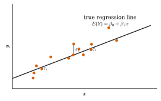
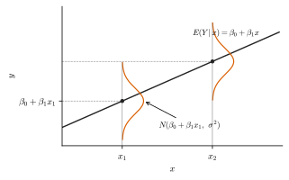
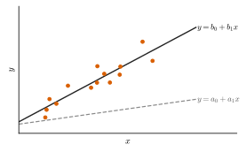
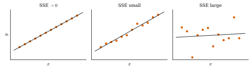

# Chapter 12: Regression and Correlation

*Bilkent University MATH 260 lecture notes, Spring 2026. [Back to contents](../README.md)*

In this chapter we are interested in how two different variables are related, so that we can use one of them to get information about the other.

## 12.1 The Simple Linear Regression Model

We want to develop a probabilistic relationship between an *independent* (explanatory) variable $x$ and a *dependent* (response) random variable $Y$. Such a relation is given by

$$
Y = (\text{deterministic function}) + (\text{a random error}) = f(x)+\varepsilon .
$$

Here $\varepsilon$ has a normal distribution with mean 0 and standard deviation $\sigma$.

**A linear probabilistic model.** For parameters $\beta_0$, $\beta_1$ and $\sigma$, the probabilistic model is

$$
Y=\beta_0+\beta_1x+\varepsilon,\qquad \varepsilon\sim N(0,\sigma^2),
$$

where $\beta_0$ is the **intercept coefficient** and $\beta_1$ is the **slope coefficient**.

Here the expectation of $Y$ is a function of $x$:

$$
E(Y) = E(\beta_0+\beta_1x+\varepsilon) = E(\beta_0)+E(\beta_1x)+\underbrace{E(\varepsilon)}_{=0} = \beta_0+\beta_1x .
$$

The graph of the mean, $E(Y)=\beta_0+\beta_1x$, is the **true regression line** (population line); the observed points scatter around it, with vertical deviations $\varepsilon_i$.

*Figure: Observed points scatter around the true regression line; the $\varepsilon_i$ are the vertical deviations.*

Now let $x_1,x_2,\dots,x_n$ be observations of $x$. If $x=x_i$, then $Y_i=\beta_0+\beta_1x_i+\varepsilon_i$. Since the $\varepsilon_i$’s are independent, the $Y_i$’s are also independent.

**Notation.**

- $\mu_{Y\mid x^{\ast}}=E(Y\mid x=x^{\ast})$: the expectation of $Y$ when $x=x^{\ast}$.

- $\sigma^2_{Y\mid x^{\ast}}=V(Y\mid x=x^{\ast})$: the variance of $Y$ when $x=x^{\ast}$.

The distribution of $Y$ is also normal (a constant plus a normal random variable is normal):

$$
E(Y\mid x)=\beta_0+\beta_1x,\qquad Y\mid x=x_1\ \sim\ N(\beta_0+\beta_1x_1,\ \sigma^2).
$$

*Figure: For each fixed $x$, $Y$ is normal with mean on the regression line and the same variance $\sigma^2$.*

## 12.2 Estimating Model Parameters

$\beta_0$, $\beta_1$ and $\sigma$ are unknown. A sample consisting of $n$ pairs $(x_1,y_1)$, …, $(x_n,y_n)$ can be used to estimate these parameters and the true regression line. Different candidate lines $y=b_0+b_1x$ can be drawn through the data; to find the “best” fit to the points, we look at the vertical deviations of the observed data points from a candidate line. This method is called the **principle of least squares**.

*Figure: Two candidate lines; least squares picks the one with the smallest sum of squared vertical deviations.*

**Principle of least squares.** The sum of squared vertical deviations from the points $(x_1,y_1)$, …, $(x_n,y_n)$ to the line $y=b_0+b_1x$ is

$$
g(b_0,b_1)=\sum_{i=1}^n\left[y_i-(b_0+b_1x_i)\right]^2 .
$$

The minimizers $\hat\beta_0$ and $\hat\beta_1$ are called the **least squares estimates**. Accordingly, the estimated regression line or **least squares regression line** (LSRL) is $y=\hat\beta_0+\hat\beta_1x$.

To minimize $g(b_0,b_1)$, we take partial derivatives and set them to zero:

$$
\begin{aligned}
\frac{\partial g(b_0,b_1)}{\partial b_0} &= \sum_{i=1}^n2\left[y_i-(b_0+b_1x_i)\right](-1)=0
\;\Rightarrow\; \sum_{i=1}^n y_i = nb_0+b_1\sum_{i=1}^n x_i, \qquad(1)\\
\frac{\partial g(b_0,b_1)}{\partial b_1} &= \sum_{i=1}^n2\left[y_i-(b_0+b_1x_i)\right](-x_i)=0
\;\Rightarrow\; \sum_{i=1}^n x_iy_i = b_0\sum_{i=1}^n x_i+b_1\sum_{i=1}^n x_i^2. \qquad(2)
\end{aligned}
$$

These equations are called the **normal equations**, and they are linear in $b_0,b_1$. The system (1)–(2) has a unique solution when at least two of the $x_i$’s are different. If all $x_i$’s are the same, the slope is *not* identifiable. Therefore $\hat\beta_0$ and $\hat\beta_1$ are the solutions of the system (1)–(2), and they minimize $g(b_0,b_1)$.

From (1) we obtain

$$
nb_0 = \sum_{i=1}^n y_i - b_1\sum_{i=1}^n x_i
\;\Rightarrow\; b_0=\frac{\sum_{i=1}^n y_i-b_1\sum_{i=1}^n x_i}{n}
\;\Rightarrow\; b_0 = \bar{y}-b_1\bar{x}
\;\Rightarrow\; \hat\beta_0 = \bar{y}-\hat\beta_1\bar{x}.
$$

From (2) we obtain (exercise to derive)

$$
b_1=\hat\beta_1=\frac{\sum_{i=1}^n(x_i-\bar{x})(y_i-\bar{y})}{\sum_{i=1}^n(x_i-\bar{x})^2}.
$$

**Proposition.** The least squares estimate of the slope coefficient $\beta_1$ of the regression line is

$$
b_1=\hat\beta_1=\frac{\sum_{i=1}^n(x_i-\bar{x})(y_i-\bar{y})}{\sum_{i=1}^n(x_i-\bar{x})^2}, \qquad(3)
$$

and the least squares estimate of the intercept coefficient $\beta_0$ of the line is

$$
b_0=\hat\beta_0=\bar{y}-\hat\beta_1\bar{x}.
$$

Moreover, under the normality assumption, $\hat\beta_0$ and $\hat\beta_1$ are the maximum likelihood estimates.

**Notation.**

$$
S_{xy}=\sum_{i=1}^n(x_i-\bar{x})(y_i-\bar{y}),\qquad
S_{xx}=\sum_{i=1}^n(x_i-\bar{x})^2,\qquad
S_{yy}=\sum_{i=1}^n(y_i-\bar{y})^2,
$$

$$
s_x^2=\frac{S_{xx}}{n-1},\qquad s_y^2=\frac{S_{yy}}{n-1}.
$$

Based on this notation, we can update (3):

$$
b_1=\hat\beta_1=\frac{S_{xy}}{S_{xx}},\qquad b_0=\hat\beta_0=\bar{y}-\hat\beta_1\bar{x}.
$$

**Residuals and estimating $\sigma$.**

$$
Y_i=\underbrace{\beta_0+\beta_1x_i}_{\text{true line}}+\underbrace{\varepsilon_i}_{\text{error}\ \sim N(0,\sigma^2)},
\qquad
y_i=\underbrace{\hat\beta_0+\hat\beta_1x_i}_{\text{estimate of the true line}\ (=\hat{y}_i)}+\underbrace{e_i}_{\text{estimate of the error}}.
$$

The residual is the leftover variation in the data after accounting for the model fit:

$$
\text{Data} = \text{Fit} + \text{Residual}.
$$

- If an observed value is above the regression line, its residual (the vertical distance between the observed data point and the line) is positive.

- If an observation is below the line, its residual is negative.

- We want to keep the residuals as small as possible to pick the right regression line.

**Definition.** The **residual** of the $i$th observation $(x_i,y_i)$ is the difference between the observed response and the estimated (fitted) response:

$$
e_i=y_i-\hat{y}_i,\qquad\text{where}\quad \hat{y}_i=\hat\beta_0+\hat\beta_1x_i,\quad i=1,\dots,n.
$$

The residuals satisfy the following properties:

1.  $\sum_i e_i=0$;

2.  $\bar{e}=0$.

**Definition.** The **error sum of squares** or **residual sum of squares** is defined by

$$
\mathrm{SSE}=\sum_i(e_i-\bar{e})^2 \overset{\text{by property 2}}{=} \sum_i e_i^2 \overset{\text{by def.\ of } e_i}{=} \sum_i(y_i-\hat{y}_i)^2 .
$$

The estimate of $\sigma^2$ is

$$
\hat\sigma^2=s_e^2=\frac{\mathrm{SSE}}{n-2}=\frac{\sum_i(y_i-\hat{y}_i)^2}{n-2},
$$

and the estimate of $\sigma$ is

$$
\hat\sigma=s_e=\sqrt{\frac{\mathrm{SSE}}{n-2}} .
$$

- Since we must first estimate the two parameters $\beta_0$ and $\beta_1$, the degrees of freedom are reduced by 2.

- The standard deviation $s_e$ is called the **residual standard deviation**.

- $E(S_e^2)=\sigma^2$, so $S_e^2$ is an unbiased estimator of $\sigma^2$.

- $E(S_e)\ne\sigma$, so $S_e$ is not an unbiased estimator of $\sigma$.

**Analogy.**

| Basic (one sample)      | Regression                             | ANOVA                                                                            |
|:------------------------|:---------------------------------------|:---------------------------------------------------------------------------------|
| $\mu$                   | $\beta_0+\beta_1x_i$                   | $\mu_i$                                                                          |
| $y_i$                   | $y_i$                                  | $x_{ij}$                                                                         |
| $\bar{y}$               | $\hat{y}_i=\hat\beta_0+\hat\beta_1x_i$ | $\bar{x}_{i\cdot}$                                                               |
| $y_i-\bar{y}$           | $y_i-\hat{y}_i$                        | $x_{ij}-\bar{x}_{i\cdot}$                                                        |
| $\sum_i(y_i-\bar{y})^2$ | $\sum_i(y_i-\hat{y}_i)^2=\mathrm{SSE}$ | $\sum_i\sum_j(x_{ij}-\bar{x}_{i\cdot})^2=\mathrm{SSE}$ (within-sample variation) |

Computing SSE directly can be difficult/time consuming. We use the following formula instead:

$$
\mathrm{SSE}=S_{yy}-\frac{S_{xy}^2}{S_{xx}},
$$

where $S_{xx}=\sum_i(x_i-\bar{x})^2$, $S_{yy}=\sum_i(y_i-\bar{y})^2$, $S_{xy}=\sum_i(x_i-\bar{x})(y_i-\bar{y})$.

**The coefficient of determination.** Consider three scatter plots:

1.  All points lie exactly on a line. There is variability in the $y$-values (the heights of the points vary significantly), but 100% of this variability can be explained by the linear regression model: SSE $=0$.

2.  Points lie close to a line. There is variability in the $y$-values; most of it can be explained by the linear regression model: SSE is small.

3.  Points form a cloud with no clear linear pattern. There is variability in the $y$-values; only a little of it can be explained by the linear regression model: SSE is large.

*Figure: Three scatter plots: all, most, and little of the variability in $y$ is explained by the line.*

The measure of total variability in the $y$-values is called the **total sum of squares**:

$$
\mathrm{SST}=\sum_i(y_i-\bar{y})^2=S_{yy}.
$$

Dividing SSE by SST gives the proportion of total variation, $\mathrm{SSE}/\mathrm{SST}$, that is *not* explained by the linear regression model. Then the explained proportion is $1-\mathrm{SSE}/\mathrm{SST}$.

**Definition.** The **coefficient of determination**, denoted by $R^2$, is

$$
R^2=1-\frac{\mathrm{SSE}}{\mathrm{SST}}.
$$

If $R^2$ is close to 1, we say that the linear regression model is successful in explaining the variability of $y$.

## 12.3 Inferences About the Regression Coefficient $\beta_1$

We want to use the standardized variable $\dfrac{\hat\beta_1-E(\hat\beta_1)}{\sigma_{\hat\beta_1}}$. When all the $x_i$’s are fixed, the $Y_i$’s are still random variables. Then

$$
\begin{aligned}
\hat\beta_1 &= \frac{\sum_i(x_i-\bar{x})(Y_i-\bar{Y})}{\sum_i(x_i-\bar{x})^2}=\frac{\sum_i(x_i-\bar{x})(Y_i-\bar{Y})}{S_{xx}}, \qquad(1)\\
\hat\beta_0 &= \bar{Y}-\hat\beta_1\bar{x}, \qquad(2)\\
\hat\sigma &= \sqrt{\frac{\sum_i(Y_i-\hat{Y}_i)^2}{n-2}} = \sqrt{\frac{\sum_i\left[Y_i-(\hat\beta_0+\hat\beta_1x_i)\right]^2}{n-2}}. \qquad(3)
\end{aligned}
$$

We can rewrite (1) as a linear function of the $Y_i$’s. Since $\sum_i(x_i-\bar{x})=\sum_i x_i-n\bar{x}=n\bar{x}-n\bar{x}=0$,

$$
\hat\beta_1=\frac{\sum_i(x_i-\bar{x})(Y_i-\bar{Y})}{S_{xx}}=\frac{\sum_i(x_i-\bar{x})Y_i-\bar{Y}\overbrace{\sum_i(x_i-\bar{x})}^{=0}}{S_{xx}}
=\sum_i\underbrace{\frac{x_i-\bar{x}}{S_{xx}}}_{c_i}Y_i=\sum_i c_iY_i .
$$

To obtain the standardized random variable, let us find the mean and variance of $\hat\beta_1$.

**1. Expectation.**

$$
\begin{aligned}
E(\hat\beta_1) &= E\!\left(\sum_i c_iY_i\right)=\sum_i c_iE(Y_i)=\sum_i c_i(\beta_0+\beta_1x_i)=\beta_0\sum_i c_i+\beta_1\sum_i c_ix_i\\
&= \beta_0\underbrace{\sum_i\frac{x_i-\bar{x}}{S_{xx}}}_{=0}+\beta_1\sum_i\frac{(x_i-\bar{x})x_i}{S_{xx}}
\\
&=\beta_1\frac{\sum_i(x_i^2-\bar{x}x_i)}{S_{xx}}=\beta_1\frac{\sum_i x_i^2-\bar{x}\sum_i x_i}{S_{xx}}=\beta_1\frac{\sum_i x_i^2-n\bar{x}^2}{S_{xx}}.
\end{aligned}
$$

Since

$$
\sum_i(x_i-\bar{x})^2=\sum_i(x_i^2-2x_i\bar{x}+\bar{x}^2)=\sum_i x_i^2-2\bar{x}\sum_i x_i+\sum_i\bar{x}^2
=\sum_i x_i^2-2n\bar{x}^2+n\bar{x}^2=\sum_i x_i^2-n\bar{x}^2,
$$

we get

$$
E(\hat\beta_1)=\beta_1\frac{\sum_i x_i^2-n\bar{x}^2}{S_{xx}}=\beta_1\frac{S_{xx}}{S_{xx}}=\beta_1 .
$$

**2. Variance.**

$$
V(\hat\beta_1)=V\!\left(\sum_i c_iY_i\right)=\sum_i c_i^2\underbrace{V(Y_i)}_{\sigma^2}
=\frac{\sum_i(x_i-\bar{x})^2}{S_{xx}^2}\sigma^2=\frac{S_{xx}}{S_{xx}^2}\sigma^2=\frac{\sigma^2}{S_{xx}}.
$$

**3. Standard deviation.** $\sigma_{\hat\beta_1}=\dfrac{\sigma}{\sqrt{S_{xx}}}$.

**4. Estimated standard deviation.** $\hat\sigma_{\hat\beta_1}=s_{\hat\beta_1}=\dfrac{s_e}{\sqrt{S_{xx}}}$.

**5.** $\hat\beta_1$ has a normal distribution, because it is a linear function of the normally distributed and independent random variables $Y_i$.

**Theorem.** The random variable

$$
T=\frac{\hat\beta_1-\beta_1}{S_{\hat\beta_1}}=\frac{\hat\beta_1-\beta_1}{S_e/\sqrt{S_{xx}}}
$$

has a $t$ distribution with $n-2$ df.

This random variable yields the following probability statement:

$$
P\!\left(-t_{\alpha/2,n-2}\lt \frac{\hat\beta_1-\beta_1}{S_{\hat\beta_1}}\lt t_{\alpha/2,n-2}\right)=1-\alpha .
$$

Then the $100(1-\alpha)\%$ CI for $\beta_1$ is

$$
\hat\beta_1\pm t_{\alpha/2,n-2}\cdot s_{\hat\beta_1}=\hat\beta_1\pm t_{\alpha/2,n-2}\cdot\frac{s_e}{\sqrt{S_{xx}}}.
$$

**Test procedure.** Null hypothesis $H_0:\beta_1=\beta_{10}$. Test statistic value:

$$
t=\frac{\hat\beta_1-\beta_{10}}{s_{\hat\beta_1}}.
$$

| Alternative hypothesis     | Rejection region                                           |
|:---------------------------|:-----------------------------------------------------------|
| $H_a:\beta_1\gt \beta_{10}$   | $t\ge t_{\alpha,n-2}$                                      |
| $H_a:\beta_1\lt \beta_{10}$   | $t\le -t_{\alpha,n-2}$                                     |
| $H_a:\beta_1\ne\beta_{10}$ | either $t\le -t_{\alpha/2,n-2}$ or $t\ge t_{\alpha/2,n-2}$ |

The $P$-value is computed as in the previous chapters.

## 12.4 Inferences About the Response

In this section we are interested in the response variable

$$
\hat{Y}=\hat\beta_0+\hat\beta_1x^{\ast},
$$

where $\hat{y}$ is the observed value of $\hat{Y}$ and $x^{\ast}$ is a specified value of $x$. First let us show that $\hat{Y}$ is a linear combination of the $Y_i$’s. We have

$$
\hat{Y}=\hat\beta_0+\hat\beta_1x^{\ast},\qquad
\hat\beta_1=\frac{\sum_i(x_i-\bar{x})(Y_i-\bar{Y})}{S_{xx}},\qquad
\hat\beta_0=\bar{Y}-\hat\beta_1\bar{x},
$$

$$
S_{xx}=\sum_i(x_i-\bar{x})^2,\qquad
\bar{Y}=\frac{1}{n}\sum_i Y_i .
$$

Then

$$
\begin{aligned}
\hat{Y} &= \bar{Y}-\hat\beta_1\bar{x}+\hat\beta_1x^{\ast} = \bar{Y}+\hat\beta_1(x^{\ast}-\bar{x})
= \frac{1}{n}\sum_i Y_i+\frac{\sum_i(x_i-\bar{x})Y_i}{S_{xx}}(x^{\ast}-\bar{x})\\
&= \sum_i\left[\frac{1}{n}+\frac{(x_i-\bar{x})(x^{\ast}-\bar{x})}{S_{xx}}\right]Y_i=\sum_i d_iY_i,
\qquad d_i=\frac{1}{n}+\frac{(x_i-\bar{x})(x^{\ast}-\bar{x})}{S_{xx}} .
\end{aligned}
$$

Then we can write the following results.

**1. Expectation.** $E(\hat{Y})=E(\hat\beta_0+\hat\beta_1x^{\ast})=E(\hat\beta_0)+x^{\ast}E(\hat\beta_1)=\beta_0+\beta_1x^{\ast}=\mu_{Y\mid x^{\ast}}$.

**2. Variance.**

$$
\begin{aligned}
V(\hat{Y}) &= V\!\left(\sum_i d_iY_i\right)=\sum_i d_i^2V(Y_i)
=\sum_i\left(\frac{1}{n}+\frac{(x_i-\bar{x})(x^{\ast}-\bar{x})}{S_{xx}}\right)^2\sigma^2\\
&=\sigma^2\sum_i\left(\frac{1}{n^2}+\frac{2(x_i-\bar{x})(x^{\ast}-\bar{x})}{nS_{xx}}+\frac{(x_i-\bar{x})^2(x^{\ast}-\bar{x})^2}{S_{xx}^2}\right)\\
&=\sigma^2\sum_i\frac{1}{n^2}+\frac{2\sigma^2(x^{\ast}-\bar{x})}{nS_{xx}}\underbrace{\sum_i(x_i-\bar{x})}_{=0}+\frac{\sigma^2(x^{\ast}-\bar{x})^2}{S_{xx}^2}\underbrace{\sum_i(x_i-\bar{x})^2}_{=S_{xx}}\\
&=\frac{\sigma^2}{n}+\frac{\sigma^2(x^{\ast}-\bar{x})^2}{S_{xx}}=\sigma^2\left(\frac{1}{n}+\frac{(x^{\ast}-\bar{x})^2}{S_{xx}}\right).
\end{aligned}
$$

**3. Standard deviation.** $\sigma_{\hat{Y}}=\sigma\sqrt{\dfrac{1}{n}+\dfrac{(x^{\ast}-\bar{x})^2}{S_{xx}}}$.

**4. Estimated standard deviation.** $\hat\sigma_{\hat{Y}}=s_{\hat{Y}}=s_e\sqrt{\dfrac{1}{n}+\dfrac{(x^{\ast}-\bar{x})^2}{S_{xx}}}$.

**5.** $\hat{Y}$ has a normal distribution, as it is a linear combination of independent and normally distributed $Y_i$’s.

**Theorem.** The random variable

$$
T=\frac{\hat{Y}-\mu_{Y\mid x^{\ast}}}{S_{\hat{Y}}}=\frac{(\hat\beta_0+\hat\beta_1x^{\ast})-(\beta_0+\beta_1x^{\ast})}{S_e\sqrt{\dfrac{1}{n}+\dfrac{(x^{\ast}-\bar{x})^2}{S_{xx}}}}
$$

has a $t$ distribution with $n-2$ df.

The $100(1-\alpha)\%$ CI for $\mu_{Y\mid x^{\ast}}$ has the endpoints

$$
\hat{y}\pm t_{\alpha/2,n-2}\cdot s_{\hat{Y}}=\hat\beta_0+\hat\beta_1x^{\ast}\pm t_{\alpha/2,n-2}\cdot s_e\sqrt{\frac{1}{n}+\frac{(x^{\ast}-\bar{x})^2}{S_{xx}}}.
$$

**Simultaneous (Bonferroni) intervals.** If we consider $m$ specified values of $x$ (e.g. $x_1^{\ast},x_2^{\ast},\dots,x_m^{\ast}$) and want a joint confidence level of $100(1-\alpha)\%$ (a **simultaneous** or **joint** CI), it suffices to use confidence level $100(1-\alpha/m)\%$ for each individual interval.

**Test procedure** (similar to previous chapters). $H_0:\mu_{Y\mid x^{\ast}}=y_0$. Test statistic value:

$$
t=\frac{\hat{y}-y_0}{s_{\hat{Y}}}.
$$

**Prediction interval.** Consider a future observation $Y$ at $x=x^{\ast}$ and the **prediction error** $\hat{Y}-Y$. To construct the interval, let us obtain the standardized random variable.

1.  Expectation: $E(\hat{Y}-Y)=E(\hat{Y})-E(Y)=\beta_0+\beta_1x^{\ast}-(\beta_0+\beta_1x^{\ast})=0$.

2.  Variance ($Y$ is independent of $\hat{Y}$):

    $$
    V(\hat{Y}-Y)=V(\hat{Y})+V(Y)=\sigma^2\left(\frac{1}{n}+\frac{(x^{\ast}-\bar{x})^2}{S_{xx}}\right)+\sigma^2=\sigma^2\left(1+\frac{1}{n}+\frac{(x^{\ast}-\bar{x})^2}{S_{xx}}\right).
    $$

    (Compare with the *estimation error* $\hat{Y}-\mu_{Y\mid x^{\ast}}$, whose variance does not include the extra 1.)

3.  Standard deviation: $\sigma_{\hat{Y}-Y}=\sigma\sqrt{1+\dfrac{1}{n}+\dfrac{(x^{\ast}-\bar{x})^2}{S_{xx}}}$.

4.  Estimated standard deviation: $\hat\sigma_{\hat{Y}-Y}=s_e\sqrt{1+\dfrac{1}{n}+\dfrac{(x^{\ast}-\bar{x})^2}{S_{xx}}}$.

**Theorem.** The random variable

$$
T=\frac{\hat{Y}-Y-0}{S_e\sqrt{1+\dfrac{1}{n}+\dfrac{(x^{\ast}-\bar{x})^2}{S_{xx}}}}
$$

has a $t$ distribution with $n-2$ df. This yields the $100(1-\alpha)\%$ **prediction interval** (PI)

$$
\hat{y}\pm t_{\alpha/2,n-2}\cdot s_e\sqrt{1+\frac{1}{n}+\frac{(x^{\ast}-\bar{x})^2}{S_{xx}}}.
$$

If $100(1-\alpha)\%$ denotes the simultaneous (joint) level of the PIs for $m$ specified values of $x$, then each individual PI should be computed at level $100(1-\alpha/m)\%$. This method is called the **Bonferroni technique**.
