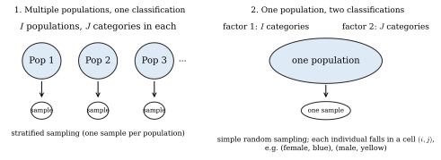

# Chapter 13: Goodness-of-Fit Tests and Categorical Data Analysis

*Bilkent University MATH 260 lecture notes, Spring 2026. [Back to contents](../README.md)*

## 13.1 Goodness-of-Fit Tests

| **Binomial experiment**                                                                                              | **Multinomial experiment**                                                                                                                                                     |
|:---------------------------------------------------------------------------------------------------------------------|:-------------------------------------------------------------------------------------------------------------------------------------------------------------------------------|
| There are two possible outcomes: success ($p$) and failure ($1-p$), with $p+(1-p)=1$.                                | There are $k$ possible outcomes with probabilities $p_1,p_2,\dots,p_k$, where $\sum_{i=1}^k p_i=1$.                                                                            |
| After $n$ trials, the probability of having $x$ successes and $n-x$ failures is $P(X=x)=\binom{n}{x}p^x(1-p)^{n-x}$. | After $n$ trials, for $x_1,\dots,x_k$ with $\sum_{i=1}^k x_i=n$, the probability is $P(X_1=x_1,\dots,X_k=x_k)=\binom{n}{x_1,x_2,\dots,x_k}p_1^{x_1}p_2^{x_2}\cdots p_k^{x_k}$. |

**Definition.** A multinomial experiment satisfies the following conditions:

1.  The experiment consists of a sequence of $n$ trials.

2.  Each trial can result in one of the $k$ possible outcomes (categories).

3.  The trials are independent.

4.  The probability that a trial results in category $i$ is $p_i$, and it is constant from trial to trial.

Also, $\sum_i p_i=1$ and $p_i\ge0$.

**Notation.**

- $p_i$: the probability (population proportion) of a trial resulting in the $i$th category.

- $p_{i0}$: the value of $p_i$ claimed by the null hypothesis (read as “$p_i$ naught”).

- $N_i$: the random variable denoting the number of trials that result in the $i$th category.

- $n_i$: the observed value of $N_i$; these are called the **observed counts**.

- $E(N_i)$: the expected value of the number of trials resulting in category $i$: $E(N_i) = (\text{total number of trials})\times(\text{hypothesized probability of category } i) = np_{i0}$. These are called the **expected counts**.

We want to compare the observed counts and the expected counts. When they differ too much, we reject $H_0$.

**Pearson’s chi-squared theorem.** If $H_0:p_1=p_{10},\dots,p_k=p_{k0}$ is true, then the test statistic

$$
\chi^2 = \sum_{\text{all categories}} \frac{(\text{observed count}-\text{expected count})^2}{\text{expected count}}
= \sum_{i=1}^k \frac{(N_i-np_{i0})^2}{np_{i0}}
$$

has approximately a chi-squared distribution with $k-1$ df. This is approximately valid when $np_{i0}\ge5$ for all $i=1,\dots,k$.

**Chi-squared goodness-of-fit test.**

- Null hypothesis: $H_0:p_1=p_{10},\dots,p_k=p_{k0}$.

- Alternative hypothesis: $H_a:$ at least one $p_i$ does not equal $p_{i0}$.

- Test statistic value: $\displaystyle\chi^2=\sum_{i=1}^k\frac{(n_i-np_{i0})^2}{np_{i0}}$.

- Rejection region: $\chi^2\ge\chi^2_{\alpha,k-1}$.

- $P$-value: the area under the $\chi^2_{k-1}$ curve to the right of the calculated $\chi^2$.

**$\chi^2$ test for completely specified probability distributions.** If we know the probability distribution and all of its parameters, the $\chi^2$ test can be applied to that scenario. For example,

$$
H_0: X\sim N(\mu,\sigma^2)\ \ (\mu,\sigma \text{ specified}),\qquad H_a: X\not\sim N(\mu,\sigma^2).
$$

- Divide $(-\infty,\infty)$ into $k$ cells: $(-\infty,a_1),[a_1,a_2),\dots,[a_{k-1},\infty)$, such that $np_{i0}\ge5$ for all $i=1,\dots,k$, where

  $$
  p_{i0}=P(a_{i-1}\le X\lt a_i)=\int_{a_{i-1}}^{a_i} f_0(x)\,dx .
  $$

- Apply the $\chi^2$ test.

**Goodness-of-fit tests for composite hypotheses.** Here the $p_i$’s are functions of unknown parameters $\theta=(\theta_1,\dots,\theta_m)$. Namely,

$$
H_0: p_1=\pi_1(\theta),\ p_2=\pi_2(\theta),\ \dots,\ p_k=\pi_k(\theta),\qquad H_a: H_0 \text{ is not true}.
$$

For $k=2$, the probability is $P(N_1=n_1,N_2=n_2)=\binom{n}{n_1}p_1^{n_1}p_2^{n_2}\propto p_1^{n_1}p_2^{n_2}$. For general $k$,

$$
P(N_1=n_1,\dots,N_k=n_k)\propto p_1^{n_1}p_2^{n_2}\cdots p_k^{n_k}
=[\pi_1(\theta)]^{n_1}[\pi_2(\theta)]^{n_2}\cdots[\pi_k(\theta)]^{n_k}, \qquad($*$)
$$

which is called the **multinomial likelihood function**.

**The method of multinomial estimation.** Let $n_1,n_2,\dots,n_k$ be the observed values of $N_1,N_2,\dots,N_k$. Then $\hat\theta_1,\hat\theta_2,\dots,\hat\theta_m$ are the maximum likelihood estimates obtained by maximizing $(*)$. The estimated expected counts are then

$$
n\hat{p}_{i0}=n\pi_i(\hat\theta). \qquad($**$)
$$

Substituting $(**)$ into Pearson’s test statistic, we obtain the following result.

**Fisher’s chi-squared theorem.** The random variable

$$
\sum_{i=1}^k\frac{(\text{observed}-\text{estimated expected})^2}{\text{estimated expected}}
=\sum_{i=1}^k\frac{(N_i-n\pi_i(\hat\theta))^2}{n\pi_i(\hat\theta)}
$$

has approximately a chi-squared distribution with $k-1-m$ df. This is valid when $n\pi_i(\hat\theta)\ge5$ for all $i$.

**$\chi^2$ test for probability distributions with unspecified parameter values.** The $\chi^2$ test can be used to test a probability distribution. For instance, suppose that we want to test $H_0:X\sim\text{Poisson}(\lambda)$. Here, since $\lambda$ is not specified and $X$ can take infinitely many values, after grouping the possible values of $X$ into cells we can apply the $\chi^2$ test (with $m=1$ estimated parameter).

## 13.2 Two-Way Contingency Tables

Here we are interested in two categorical classifications. This usually happens in two ways:

1.  **Multiple populations, one classification.** There are $I$ populations and $J$ categories in each population (stratified sampling: a separate sample is taken from each population).

2.  **One population, two classifications.** There is one population and two variables (factors); the first factor has $I$ categories and the second factor has $J$ categories (simple random sampling). Example: sex (female/male) and a colour preference.

*Figure: The two ways a two-way contingency table arises.*

**1. Multiple populations, one classification.**

- $N_{ij}$: the number of individuals in the $i$th sample falling in the $j$th category.

- $n_{ij}$: the observed counts. A table displaying the $n_{ij}$ is called a **two-way contingency table**.

- $N_{\cdot j}$: the number of individuals among the $n$ sampled falling in the $j$th category.

- $N_{i\cdot}=n_i$: the number of individuals in the $i$th sample (the $i$th sample size).

Recall Pearson’s test statistic value:

$$
H_0:p_1=p_{10},\dots,p_k=p_{k0}:\quad \chi^2=\sum_{i=1}^k\frac{(n_i-np_{i0})^2}{np_{i0}};
$$

$$
H_0:p_1=\pi_1(\theta),\dots,p_k=\pi_k(\theta):\quad \hat{e}_i=n\pi_i(\hat\theta).
$$

Under the homogeneity null hypothesis, each population has the same category probabilities $p_1,\dots,p_J$, so

$$
E(N_{ij}) = n_ip_j. \qquad(1)
$$

The estimator of $p_j$ is

$$
\hat{p}_j = \frac{N_{\cdot j}}{n}. \qquad(2)
$$

Substituting (2) into (1) yields the estimated expected counts

$$
\hat{e}_{ij} = n_i\frac{n_{\cdot j}}{n} = \frac{(i\text{th row total})(j\text{th column total})}{n}.
$$

**$\chi^2$ test for homogeneity.**

- $H_0: p_{1j}=p_{2j}=\dots=p_{Ij}$ for every $j=1,\dots,J$.

- $H_a: H_0$ is not true.

- Test statistic value:

  $$
  \chi^2=\sum_{\text{all cells}}\frac{(\text{observed}-\text{estimated expected})^2}{\text{estimated expected}}
  =\sum_{i=1}^I\sum_{j=1}^J\frac{(n_{ij}-\hat{e}_{ij})^2}{\hat{e}_{ij}} .
  $$

- Rejection region: $\chi^2\ge\chi^2_{\alpha,(I-1)(J-1)}$.

- $P$-value: the area under the $\chi^2_{(I-1)(J-1)}$ curve to the right of the calculated $\chi^2$.

This is valid when $\hat{e}_{ij}\ge5$ for all $i,j$.

**2. One population, two classifications.**

- $N_{ij}$: the number of individuals in the $(i,j)$th category.

- $n_{ij}$: the observed counts.

- $p_{ij}$: the proportion of individuals in the population falling in the $(i,j)$th category, i.e. $p_{ij}=P(\text{a randomly selected individual is in category } i \text{ of factor 1 and category } j \text{ of factor 2})$.

- $p_{\cdot j}=\sum_{i=1}^I p_{ij}=P(\text{a randomly selected individual is in category } j \text{ of factor 2})$.

- $p_{i\cdot}=\sum_{j=1}^J p_{ij}=P(\text{a randomly selected individual is in category } i \text{ of factor 1})$.

Then

$$
E(N_{ij}) = np_{ij}. \qquad(3)
$$

Since we are interested in testing for independence, the null hypothesis is $H_0$: the individual’s category of factor 1 is independent of its category of factor 2, i.e.

$$
p_{ij}=p_{i\cdot}\,p_{\cdot j}\quad\text{for all } i,j.
$$

Then we can rewrite (3) as

$$
E(N_{ij}) = np_{i\cdot}\,p_{\cdot j}. \qquad(4)
$$

The estimators of $p_{i\cdot}$ and $p_{\cdot j}$ are

$$
\hat{p}_{i\cdot}=\frac{N_{i\cdot}}{n},\qquad \hat{p}_{\cdot j}=\frac{N_{\cdot j}}{n}. \qquad(5)
$$

Substituting (5) into (4), we get

$$
\hat{e}_{ij} = n\hat{p}_{i\cdot}\hat{p}_{\cdot j} = n\frac{n_{i\cdot}}{n}\frac{n_{\cdot j}}{n} = \frac{n_{i\cdot}\,n_{\cdot j}}{n}.
$$

**$\chi^2$ test for independence.**

- Null hypothesis: $H_0: p_{ij}=p_{i\cdot}\,p_{\cdot j}$ for all $i,j$.

- Alternative hypothesis: $H_a: H_0$ is not true.

- Test statistic value: $\displaystyle\chi^2=\sum_{i=1}^I\sum_{j=1}^J\frac{(n_{ij}-\hat{e}_{ij})^2}{\hat{e}_{ij}}$.

- Rejection region: $\chi^2\ge\chi^2_{\alpha,(I-1)(J-1)}$.

- $P$-value: the area under the $\chi^2_{(I-1)(J-1)}$ curve to the right of the calculated $\chi^2$.

This is valid when $\hat{e}_{ij}\ge5$ for all $i,j$.
